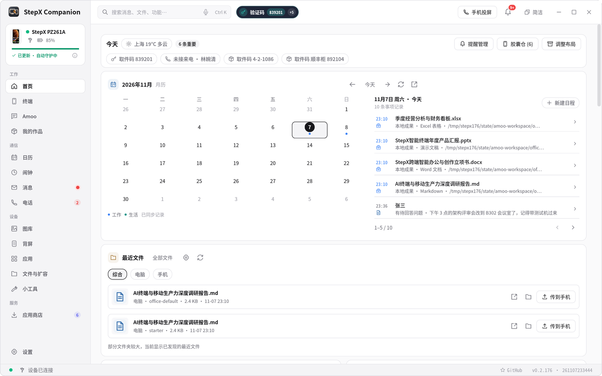

<div align="center">


# StepX Companion

### 用 AI 连接手机和电脑，让信息、工具和服务跟着人走

**人在哪里，哪里就是中心。** 在电脑工作时，手机上的消息、安排、文件与 AI 成果也能接着用。

Linux / macOS / Windows · Rust 原生客户端 · 面向 STEPX Neo / PZ261A

[下载安装](https://github.com/xydzf520/stepx/releases/latest) · [快速开始](docs/GETTING_STARTED.md) · [更新日志](CHANGELOG.md) · [反馈问题](https://github.com/xydzf520/stepx/issues)

</div>

> **我正在找工作，欢迎联系或内推。** 我是董正法，寻求 **产品岗 / AI 产品岗 / 产品与 AI 应用开发复合岗**，上海及周边、华东地区均可。10 年以上产品与管理经验，既能带团队推进业务，也能借助 AI 独立完成从调研、规划、体验设计到业务开发、测试、部署和迭代的交付。做过 App、软硬件协同产品和企业 AI 平台。
>
> **微信：164245026 · 邮箱：f@ab.cool**。完整经历、个人微信与交流群二维码可在客户端「设置 → 关于」查看。

面向 STEPX 用户的社区项目，与 STEPX、Amoo、Google 无官方隶属关系。普通 Android 不在本版支持范围；原厂专有能力仍依赖对应固件、权限和账号。

## 先看你最常用的几个场景

| 你在做什么 | StepX 怎么帮你 |
| --- | --- |
| 正在写文档，手机又有新消息 | 右下角独立提醒不抢输入焦点；验证码一键复制，最新消息优先，红包有独立样式。可暂不提醒、按应用关闭，或清理本次弹窗。 |
| 等快递、怕漏会议和未接电话 | 顶部实况胶囊集中显示仍需处理的事。规则先判断，Agent 可辅助复核；证据不足保留未知，取件和已完成事项及时收起。 |
| 早上想知道今天怎么安排 | 首页完整月历排第一，工作与生活用两种颜色标记。16 个模块可调整顺序、大小和显隐，编辑支持撤销与取消。 |
| 刚生成 PDF、保存图片或拍了照片 | 首页和「文件与扩容」都能看到最近文件。电脑与手机合并查看，打开、传到手机或保存到电脑，不限定来源软件。 |
| 忘记消息或资料放在哪里 | `Ctrl K` 全局搜索，默认综合，可切手机 / 电脑；按消息、文件、Amoo、日历、功能等分类定位。 |
| 手机放在一边，电脑继续工作 | USB 或纯无线同步；已授权的后台数据读取可在熄屏时继续，生成方案不占用消息同步队列。 |
| 讨论结束，需要真正的成果 | 沿用手机账号的可用 AI 能力，整理方案、待办和日 / 周 / 月回顾，关联依据，再把文件送回手机继续用。 |



*图片来自原生客户端隔离演示，素材版本与验证范围见 [素材来源](desktop/assets/release-notes/0.2.177/sources.json)。*

## 两段视频：看更新，也看怎么用

- [公开版 0.2.60 → 0.2.177：这次有哪些值得用的变化](docs/videos/StepX-0.2.60-to-0.2.177.mp4)
- [StepX 产品介绍：让信息、工具和服务跟着人走](docs/videos/StepX-product-0.2.177.mp4)
- [适合发群的介绍与更新文案](docs/SHARE_0_2_177.md) · [完整分镜、字幕及素材说明](docs/videos/README.md)

视频开头说明产品理念，使用真实客户端界面和隔离演示数据；支持条件会在相应画面标注。作者求职与联系信息保留在片尾。旧版 [0.2.59 更新视频](https://github.com/xydzf520/stepx/releases/download/v0.2.59/StepX-Companion-0.2.59-update-wechat.mp4) 仍可回看。

## 公开版 0.2.60 → 0.2.177

本次累计更新覆盖桌面提醒、胶囊、首页、最近文件、搜索、消息电话、AI 成果、日程与手机工具；[按用户场景查看全部更新](docs/RELEASE_NOTES.md)。客户端的图文说明可随时从 **设置 → 关于** 再次打开。

性能优化集中在减少重复工作：数据库事务与索引、增量写入与分页、缩略图和字体缓存、独立同步队列，以及宽窗口布局与拖动渲染。不同操作收益不同，完整快照写入仍有成本；不把单项测试推广为“全线提速”。 [首页复测方法与结果](docs/PERFORMANCE.md)。

**0.2.177 重点修复**：macOS 文件选择 / 保存改为隔离进程与异步续办，避开后台 AppKit 窗口和模态重入；弹窗菜单增加「清理本次弹窗」；公开导出和安装包收紧资源范围，排除开发机数据。各平台包以发布页实际可下载内容为准。

### 能力边界，先说清楚

- **电脑接听**：已有 Linux + 支持固件的纯无线双向通话实测；可选择手机接听、挂断和回拨。尚不能将结果推广为 Windows / macOS 全面音频兼容。
- **消息**：检索和呈现的是已同步内容；通知来源不等于微信全量聊天历史。后台回复需要手机提供可用的通知回复入口。
- **搜索**：手机文件与图片主要按名称检索；电脑指定目录可检索支持的文本内容，不代表任意文件内容均能解析。
- **手机 AI**：遵循当前账号与模型的实际权限、额度和计量。GUI 执行模型可能单独配置；未将云端语音当作手机端侧语音，原厂通用离线 ASR / TTS 尚未开放验证。
- **macOS 修复**：代码与构建检查不替代苹果实体设备验收；安装包使用 ad-hoc 签名，未 Apple 公证。

## 特色功能

### Amoo：聊完之后，还能接着做


- **继续手机上的对话**：沿用手机 Amoo 账号，收发文字、图片与文件；格式化显示回复，支持选中复制、右键操作和朗读。
- **处理工作资料**：生成可编辑的 Word、Excel 与 PPT，预览成果并继续修改；图片结果下载后缓存在电脑，减少短期链接失效影响。
- **制作手机小应用**：调用手机模型或自己配置的模型，生成应用、在电脑浏览器检查，再发送至伴侣离线作品库。Studio 官网草稿和编辑入口也在工作流中衔接。
- **普通聊天保持轻松**：可识别文件、图片或应用需求，也可改回普通对话；工具过程收起，成果单独成卡片。
- **能力和用量可见**：查看接口可获取的技能、记忆、模型、MCP、定时任务及 Token 信息；缺失数据不会冒充账单。
- **简洁模式**：小窗口里继续当前对话；输入、附件、发送合在一起，切换窗口保留草稿和附件。

**用上手机已有的百亿 Token 权益**：已开通相应购机权益的用户，手机模型任务沿用原账号的额度与计量规则。额度、有效期、模型以手机账号实际可用为准，客户端不额外赠送 Token。自有模型 API 与 GUI Agent 模型服务独立配置、独立计费。

### 手机空间，按需释放

| 功能 | 文件在哪里 | 使用方式 |
| --- | --- | --- |
| **空间压缩与清理** | 留在手机 | 对适合的文档压缩，核对收益后处理；集中查看重复文件和可清理项，支持还原压缩文件 |
| **存储扩容** | 电脑保存原件，手机保留入口 | 选择照片、视频、文档与保留时间，确认规则后自动迁移；保存并校验成功才清理手机原件，支持取回 |
| **相册联动** | 手机照片与扩容原件统一查看 | 按类型和来源筛选、预览、排序；隐藏内部缩略图及回收站残留，离线状态明确提示 |


### 背屏不只是装饰

- **图案与动画**：17 × 23 点阵、379 颗灯珠；太空人、像素动画、图片转点阵，调亮度、速度与时长，先预览再应用。
- **用背屏打游戏**：「重力对齐」三敲开局，左右倾斜控制长条，5 格到 1 格循环挑战，累计积分，翻到正面退出。
- **脱离电脑游玩**：安装并启用伴侣相应能力后，由手机运行；背屏输出仍受姿态保护和系统权限约束。


### Google Play 与小工具

在已适配固件上安装 Google Play 及必要组件，配套安装前检查、权限检查、回执和兼容性诊断。小工具还集中提供空间释放、手机 OTA 检测、投屏、APK 管理、输入法安装和伴侣安装维护。

**Google Play 安装、GMS 登录和设备认证是不同事项。** 本项目不能给未经认证的机型授予 Google 认证；X 原生 Google 登录的设备证明拒绝尚未解决。公开包不分发 Google APK，安装流程使用指定上游来源并核验完整性。

## 常用能力，一个客户端完成

| 能力 | 可以做什么 |
| --- | --- |
| **投屏与控制** | USB / 无线查看画面；鼠标键盘操作；跟随画面的侧栏提供主页、返回、多任务、音量、截图和结束投屏 |
| **局域网投屏** | 手机连接本电脑后，同网浏览器扫码观看；每次启动独立链接，远端控制默认关闭。DLNA / 旧版 AirPlay 为实验性适配 |
| **文件互传** | 目录导航、上传下载、双击打开、右键菜单、重命名与回收站；传输状态和校验结果可查 |
| **应用商店** | 分类搜索、详情与截图、来源选择、下载 APK、安装及更新检查；安装前核对包名与签名 |
| **应用管理** | 真实名称与图标，查看列表、安装 APK、导出及卸载；操作前显示范围和确认 |
| **短信、电话、通知** | 读取手机返回的数据，在支持授权下发短信、拨号、回复通知；失败原因明确显示 |
| **相册、日历、闹钟** | 在电脑整理手机照片，查看日程及闹钟，关联 Amoo 处理入口 |
| **设备状态** | 首页电池、温度、存储、可获取的 Token 用量；底部统一显示连接、版本、加载与更新状态 |
| **连接恢复** | USB 引导、扫码/数字配对、已信任设备发现；同局域网动态端口重连，适配固件可配置重启恢复 |


*以上为应用实际渲染的演示界面，使用虚构数据，不代表所有机型均已通过端到端测试。*

## StepX伴侣：手机端的协作入口

扫码连接、文件接收、离线作品库、背屏游戏和后台协作集中在同一个 App。权限按功能说明，安装器检查包名与签名，系统适配核对设备身份和固件；重启后首次密码解锁仍需本人完成。

实验性 GUI Agent 支持手机执行看屏、点击、滑动和输入，桌面提供控制入口。公开仓库包含适配层和构建脚本，**普通公开 APK 不包含许可尚未明确的 Neo 上游执行引擎**；完整组合构建见 [Neo 适配说明](desktop/neo-agent-adapter/README.md)。完整引擎配置后，可在「小工具 → GUI Agent → 连接 Amoo」安装调用技能，再新建普通对话委派任务。已在 PZ261A / StepAOS 1.0.0.2（172 固件）验证“打开京东，我的订单”通过原生 MCP 在后台虚拟屏完成，手机前台仍可使用；其他应用兼容性需分别验证。手机需解锁，GUI Agent 的视觉模型独立配置。

Studio 首次网页登录需要本人完成；之后可以复用已授权会话。已验证的手机交付路径是伴侣离线作品库；官网云预览仍受平台状态限制。详见 [Studio 说明](docs/STUDIO_INTEGRATION.md) 与 [验收记录](docs/STUDIO_VERIFICATION.md)。

## 下载与兼容性

| 电脑 | 下载包 | 注意事项 |
| --- | --- | --- |
| Windows x64 | `StepX-Companion-0.2.177-windows-x86_64.zip` | 必要时安装手机 USB 驱动；无商业代码签名 |
| macOS Apple Silicon | `StepX-Companion-0.2.177-macos-arm64.zip` | 包内为 `.app`；ad-hoc 签名，未 Apple 公证 |
| macOS Intel | `StepX-Companion-0.2.177-macos-x86_64.zip` | 与 ARM 版分开下载；旧系统未全面验证 |
| Linux x64 | `StepX-Companion-0.2.177-linux-x86_64.tar.gz` | Ubuntu 24.04 构建基线，glibc 2.39+；旧环境可源码构建 |

发布包提供 **ADB、scrcpy、Python、Java 与 APK 校验工具**，无需预装 Android Studio。请完整解压，不要只复制可执行文件。每个包附 SHA-256；Windows/macOS 的原生构建与运行时验证不等于所有实体电脑均已联调。[完整验证边界 →](docs/CROSS_PLATFORM_0_2_59.md)

主要设备为 PZ261A；高级权限/重启恢复适配 Android 16 / 172 固件，未知固件不跳过检查强装。普通 Android 目前会被客户端设备识别拦截，不列入支持范围；手机伴侣最低 Android 13。同局域网自动发现需要设备互访和 mDNS，防火墙或访客网络隔离可能阻止连接。

## 快速开始

1. 下载对应电脑架构的完整包，解压运行。
2. 按新手弹窗开启手机开发者选项、USB 调试，连接数据线并在手机授权。
3. 在「连接设备」选择手机，按需安装 StepX伴侣并确认所需权限。
4. 需要无线连接时，在同一可信局域网完成一次扫码或数字配对。
5. 进入 Amoo 聊天，或使用文件、相册、背屏和小工具。通过「设置」调整目录、快捷键、外观及自有模型。

[详细步骤](docs/GETTING_STARTED.md) · [存储扩容](docs/STORAGE_EXPANSION.md) · [Amoo 工作区](docs/AMOO_WORKSPACE.md)

固件与跨端协作开发：见 [安装与连接说明](docs/GETTING_STARTED.md) 和 [172 固件 MCP 清单](scripts/firmware-profiles/pandora-172-mcp.json)。新增固件必须重新核验接口和业务，不直接沿用旧补丁。

## 数据留在你的用户目录

公开源码与安装包只带运行程序、资源和必要工具，不带开发机的聊天、数据库、设备记录、截图、日志、备份或模型密钥。软件正常使用需要保存自己的设置、同步缓存与文件；这些数据留在当前电脑的用户目录，并不因为项目开源而上传到 GitHub。

向模型生成内容、给手机传输文件等功能仍会按你启用的服务发送所需内容。清理缓存、删除记录和迁移原文件是不同操作，具体范围在设置与操作确认中说明。排障日志请先脱敏再提交。

## 开发与贡献

```sh
git clone https://github.com/xydzf520/stepx.git
cd stepx
cargo build --release --locked --manifest-path desktop/Cargo.toml
```

UI 依赖已放在 `vendor/`。系统依赖、Android 构建和打包见 [构建指南](docs/BUILDING.md)。欢迎提交复现步骤、跨平台问题和 Pull Request。

## 许可与联系

源码按 **AGPL-3.0-only** 发布，第三方组件遵循各自许可：[LICENSE](LICENSE) · [NOTICE](NOTICE) · [第三方说明](THIRD_PARTY_NOTICES.md)。品牌、标志和原厂素材权利归原权利人所有；源码许可不授予商标权。

仓库不包含账号密钥、个人手机备份或私有聊天记录。系统维护属于实验性能力，执行前请阅读界面的范围与恢复说明。

目前在上海，寻求产品岗及复合型岗位机会，欢迎交流与推荐。**微信：164245026**。如有内容涉及侵权，请联系我，我会及时核实并删除。客户端「设置 → 关于」也提供项目与联系信息。
