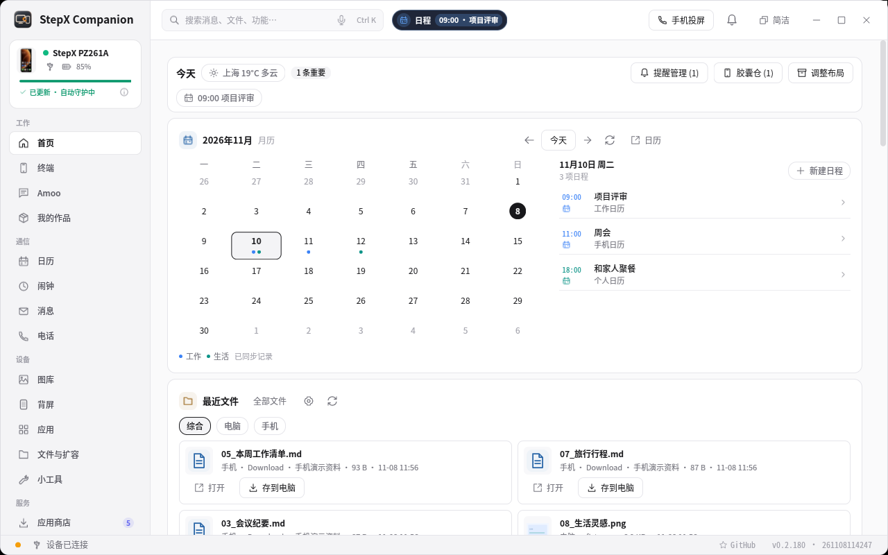
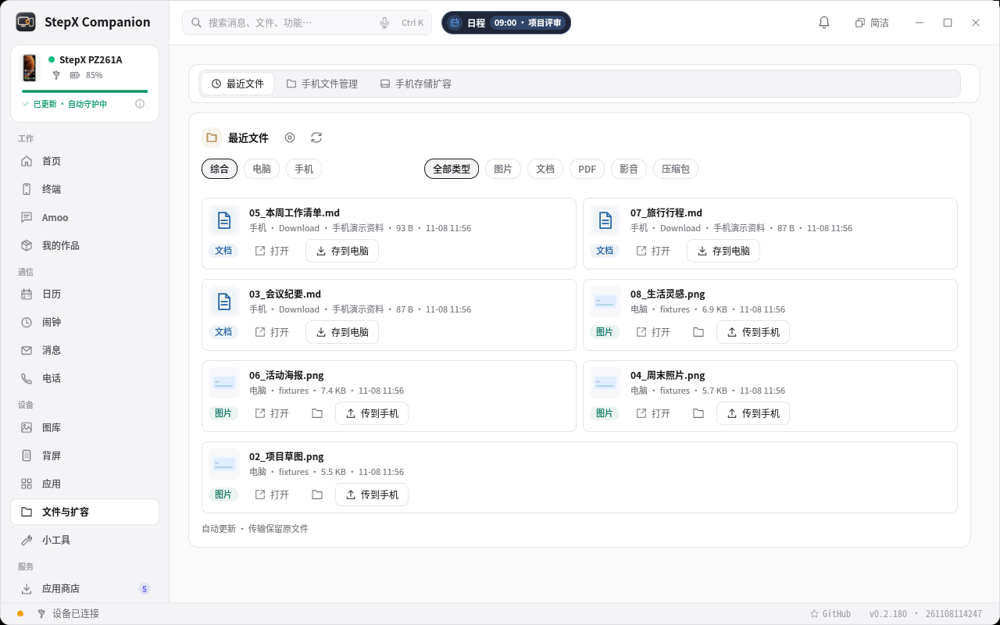

<div align="center">


# StepX Companion

### 以人为中心，让 AI 贯通终端与服务。

连接手机与电脑上的消息、文件、安排、工具与 AI 成果，让提醒及时到达，让工作与生活跨端继续。

Linux / macOS / Windows · Rust 原生客户端 · 面向 STEPX Neo / PZ261A

[下载安装](https://github.com/xydzf520/stepx/releases/latest) · [快速开始](docs/GETTING_STARTED.md) · [更新日志](CHANGELOG.md) · [反馈问题](https://github.com/xydzf520/stepx/issues)

</div>

面向 STEPX 用户的社区项目，与 STEPX、Amoo、Google 无官方隶属关系。普通 Android 不在本版支持范围；原厂专有能力仍依赖对应固件、权限和账号。

## 先看你最常用的几个场景

| 你在做什么 | StepX 怎么帮你 |
| --- | --- |
| 正在写文档，手机又有新消息 | 右下角独立提醒不抢输入焦点；验证码一键复制，最新消息优先，红包有独立样式。可暂不提醒、按应用关闭，或清理本次弹窗。 |
| 等快递、怕漏会议和未接电话 | 顶部实况胶囊集中显示仍需处理的事。规则先判断，Agent 可辅助复核；证据不足保留未知，取件和已完成事项及时收起。 |
| 早上想知道今天怎么安排 | 首页完整月历排第一，工作与生活用两种颜色标记。16 个模块可调整顺序、大小和显隐，编辑支持撤销与取消。 |
| 刚生成 PDF、保存图片或拍了照片 | 首页和「文件与扩容」都能看到最近文件。电脑与手机合并查看，打开、传到手机或保存到电脑，不限定来源软件。 |
| 忘记消息或资料放在哪里 | `Ctrl K` 打开先看最近文件，输入关键词统一查找；综合 / 手机 / 电脑按需筛选，按消息、文件、Amoo、日历、功能等分类定位。 |
| 手机放在一边，电脑继续工作 | USB 或纯无线同步；已授权的后台数据读取可在熄屏时继续，生成方案不占用消息同步队列。 |
| 讨论结束，需要真正的成果 | 沿用手机账号的可用 AI 能力，整理方案、待办和日 / 周 / 月回顾，关联依据，再把文件送回手机继续用。 |



*图片来自原生客户端隔离演示，素材版本与验证范围见 [素材来源](desktop/assets/release-notes/0.2.180/sources.json)。*

## 两段视频：看更新，也看怎么用

- [公开版 0.2.60 → 0.2.180：这次有哪些值得用的变化](docs/videos/StepX-0.2.60-to-0.2.180.mp4)
- [StepX 产品介绍：以人为中心，让 AI 贯通终端与服务](docs/videos/StepX-product-0.2.180.mp4)
- [适合发群的介绍与更新文案](docs/SHARE_0_2_180.md) · [完整分镜、字幕及素材说明](docs/videos/README.md)

两段视频都从最新 0.2.180 的完整界面点击进入功能：产品片覆盖从连接到日常使用的完整场景，更新片明确比较 0.2.60 → 0.2.180。录制使用隔离演示资料，关键支持条件在对应画面说明。旧版 [0.2.59 更新视频](https://github.com/xydzf520/stepx/releases/download/v0.2.59/StepX-Companion-0.2.59-update-wechat.mp4) 仍可回看。

## 公开版 0.2.60 → 0.2.180

本次累计更新覆盖桌面提醒、胶囊、首页、最近文件、搜索、消息电话、AI 成果、日程与手机工具；[按用户场景查看全部更新](docs/RELEASE_0_2_180.md)。客户端的图文说明可随时从 **设置 → 关于** 再次打开。

性能优化集中在减少重复处理与等待，已有两组可核对的对比：

| 测试场景 | 修改前 → 修改后 | 如何理解 |
| --- | --- | --- |
| 2 万条记录中修改 1,000 条，热快照持久写入 | 44.054 → 8.545 ms（中位数） | 比旧 SQLite 实现约快 5.16 倍；仍慢于同轮 JSON 的 3.887 ms |
| 1,000 个任务中保存一份草稿，含克隆、比较与提交 | 1.569 → 0.474 ms（中位数） | 处理成本约降为原来的 30%；不含原有捕获及合并等待时间 |

以上为 0.2.154 集成的同机、合成数据对比，保留持久化要求；不能推导整机、所有页面或网络同步的统一提速。0.2.180 在 6 种宽高下验证首页布局和交互，并对 30 个视图构造场景做性能检查；视图构造耗时不是 GPU 帧率或端到端延迟。[数据、方法与限制](docs/PERFORMANCE.md) · [写入原始对比](docs/storage-batch-performance-0.2.154.md)。

**0.2.178–0.2.180 最新变化**：打开搜索直接看到最近文件；首页按实际宽高调整内容，同排卡片底边对齐、独占一行时利用可用空间，保留所选尺寸与模块。尺寸可点击选择或拖动调整，移动、隐藏和场景选择都有明确反馈。此前的 macOS 文件窗口隔离、弹窗批次清理与发布资源检查继续保留。各平台包以发布页实际可下载内容为准。

### 能力边界，先说清楚

- **电脑接听**：已有 Linux + 支持固件的纯无线双向通话实测；可选择手机接听、挂断和回拨。尚不能将结果推广为 Windows / macOS 全面音频兼容。
- **消息**：检索和呈现的是已同步内容；通知来源不等于微信全量聊天历史。后台回复需要手机提供可用的通知回复入口。
- **搜索**：手机文件与图片主要按名称检索；电脑指定目录可检索支持的文本内容，不代表任意文件内容均能解析。
- **手机 AI**：遵循当前账号与模型的实际权限、额度和计量。GUI 执行模型可能单独配置；未将云端语音当作手机端侧语音，原厂通用离线 ASR / TTS 尚未开放验证。
- **macOS 修复**：代码与构建检查不替代苹果实体设备验收；安装包使用 ad-hoc 签名，未 Apple 公证。

## 功能地图：现在能做什么，何时加入或改进

**公开基线：0.2.60（2026-10-28） → 最新版本：0.2.180（2026-11-08）。**

“已有”表示 0.2.60 已经具备，并非本次新增；表中列的是关键变化节点。期间部分版本是开发迭代记录，不表示每个版本都曾公开发行。点击版本可查原始记录，更多节点见 [功能版本索引](docs/FEATURE_HISTORY.md)，具体用法见 [完整功能说明](docs/FEATURE_GUIDE.md)。

| 功能 | 对用户有什么用 | 已有 / 新增 / 改版 | 本轮关键改进 |
| --- | --- | --- | --- |
| **桌面提醒与消息中心** | 验证码复制、红包样式、合并提醒、按应用暂不提醒；清理当前弹窗保留历史和未来提醒 | 独立弹窗 [0.2.136](CHANGELOG.md#02136--2026-11-06本地测试版) · 2026-11-06 | [0.2.177](CHANGELOG.md#02177--2026-11-08) · 2026-11-08 |
| **实况胶囊** | 日程、物流、未接来电集中处理；寄件/收件不混淆，完成退出；规则优先、Agent 可选复核 | 场景整合 [0.2.100](CHANGELOG.md#02100--2026-11-03本地测试版) · 2026-11-03 | [0.2.160](CHANGELOG.md#02160--2026-11-07) · 2026-11-07 |
| **首页工作台** | 全月月历在前；16 模块可调整，按卡片宽高突出核心内容，拖动与尺寸选择有反馈 | 月历重构 [0.2.155](CHANGELOG.md#02155--2026-11-07) · 2026-11-07 | [0.2.180](CHANGELOG.md#02180--2026-11-08) · 2026-11-08 |
| **最近文件** | 电脑刚保存的文档与手机新照片集中看，直接打开、双向传输；首页、文件页、搜索都有入口 | 新增 [0.2.147](CHANGELOG.md#02147--2026-11-06) · 2026-11-06 | [0.2.180](CHANGELOG.md#02180--2026-11-08) · 2026-11-08 |
| **全局搜索** | 打开先看最近文件；输入关键词搜索已同步消息、文件、Amoo、作品、安排、应用与功能 | 新增 [0.2.143](CHANGELOG.md#02143--2026-11-06) · 2026-11-06 | [0.2.178](CHANGELOG.md#02178--2026-11-08) · 2026-11-08 |
| **消息与短信** | 查看已同步记录；可用回复入口下后台回复；详情不撑开聊天，发出记录不被刷新丢弃 | 0.2.60 已有 · 2026-10-28 | [0.2.138](CHANGELOG.md#02138--2026-11-06) · 2026-11-06 |
| **电话与来电弹窗** | 来电人和号码、手机/电脑接听、挂断与回拨；电脑音频目前以支持手机 + Linux 实测为准 | 实时来电 [0.2.163](CHANGELOG.md#02163--2026-11-07) · 2026-11-07 | [0.2.166](CHANGELOG.md#02166--2026-11-07) · 2026-11-07 |
| **Amoo 与办公成果** | 继续手机对话，处理图片、文件，制作 Word / Excel / PPT；校验后回传手机，断线可续办 | 0.2.60 已有 · 2026-10-28 | [0.2.64](CHANGELOG.md#0264--2026-10-28本地测试版) · 2026-10-28 |
| **跨 App 资料与复盘** | 按明确项目与链接关联依据，形成方案、待办、日周月回顾；允许人工纠正，历史不足明确说明 | [0.2.66](CHANGELOG.md#0266--2026-10-29本地测试版) · 2026-10-29 | [0.2.67](CHANGELOG.md#0267--2026-10-29本地测试版) · 2026-10-29 |
| **Agent 与 AI 来源** | 独立设置，找资料、拟回复、讨论待办、日程草稿、方案清单；手机账号或独立 API 明确选择 | 来源设置 [0.2.93](CHANGELOG.md#0293--2026-11-02本地测试版) · 2026-11-02 | [0.2.162](CHANGELOG.md#02162--2026-11-07) · 2026-11-07 |
| **日历与闹钟** | 电脑查看和管理；工作/生活最多两色点，重复日程与跨日安排按日期展示 | 0.2.60 已有 · 2026-10-28 | [0.2.161](CHANGELOG.md#02161--2026-11-07) · 2026-11-07 |
| **相册、扩容与文件管理** | 查看照片、迁移与取回原件、目录操作；迁移校验后才清理，文件回收/恢复优先原生 MCP | 0.2.60 已有 · 2026-10-28 | [0.2.128](CHANGELOG.md#02128--2026-11-05本地测试版) · 2026-11-05 |
| **背屏** | 点阵、动画、小游戏及参数预览；停止后按原快照恢复，不用默认值覆盖原设置 | 0.2.60 已有 · 2026-10-28 | [0.2.176](CHANGELOG.md#02176--2026-11-07) · 2026-11-07 |
| **投屏、应用与商店** | USB/无线控制、局域网浏览器观看；应用搜索、安装、更新及管理 | 0.2.60 已有 · 2026-10-28 | [0.2.127](CHANGELOG.md#02127--2026-11-05本地测试版) · 2026-11-05 |
| **手机工具与 MCP** | 设置、剪贴板、日历、闹钟等优先调用手机实际开放的原生接口，失败有回执 | 0.2.60 已有 · 2026-10-28 | [0.2.128](CHANGELOG.md#02128--2026-11-05本地测试版) · 2026-11-05 |
| **连接与电池** | 动态端口与设备身份核验；熄屏同步、失效读取恢复，充电状态复用消息快照更新 | 0.2.60 已有 · 2026-10-28 | [0.2.173](CHANGELOG.md#02173--2026-11-07) · 2026-11-07 |
| **数据保存与性能** | 事务、增量保存、中文索引、分页与缓存；备份恢复和自动清理有明确范围 | 存储重构 [0.2.153](CHANGELOG.md#02153--2026-11-06) · 2026-11-06 | [0.2.154](CHANGELOG.md#02154--2026-11-07) · 2026-11-07 |
| **跨平台与发布** | 四平台安装包，隔离文件窗口、路径迁移、断线防重复提交及发布数据排除 | 0.2.60 已有 · 2026-10-28 | [0.2.177](CHANGELOG.md#02177--2026-11-08) · 2026-11-08 |



*原生客户端隔离演示界面；不表示所有机型、平台均已通过端到端验证。*

## 版本时间线（最新在前）

| 日期 | 版本节点 | 这一阶段主要改善 |
| --- | --- | --- |
| 2026-11-08 | [0.2.180](CHANGELOG.md#02180--2026-11-08)、[0.2.179](CHANGELOG.md#02179--2026-11-08)、[0.2.178](CHANGELOG.md#02178--2026-11-08) | 首页卡片自适应与对齐、布局编辑反馈；搜索直接展示最近文件 |
| 2026-11-08 | [0.2.177](CHANGELOG.md#02177--2026-11-08) | 跨平台可靠性、清理本次弹窗、发布资源检查 |
| 2026-11-07 | [0.2.176](CHANGELOG.md#02176--2026-11-07)、[0.2.173](CHANGELOG.md#02173--2026-11-07) | 首页布局与宽窗口响应、背屏恢复、电池与充电状态 |
| 2026-11-07 | [0.2.167](CHANGELOG.md#02167--2026-11-07)、[0.2.166](CHANGELOG.md#02166--2026-11-07)、[0.2.164](CHANGELOG.md#02164--2026-11-07)、[0.2.163](CHANGELOG.md#02163--2026-11-07) | 提醒顺序与输入保护、来电控制与电脑音频、无线读取恢复 |
| 2026-11-07 | [0.2.162](CHANGELOG.md#02162--2026-11-07)、[0.2.161](CHANGELOG.md#02161--2026-11-07)、[0.2.160](CHANGELOG.md#02160--2026-11-07) | 独立 Agent、工作生活双色日历、物流判断与完成退出 |
| 2026-11-06 / 2026-11-07 | [0.2.154](CHANGELOG.md#02154--2026-11-07)、[0.2.153](CHANGELOG.md#02153--2026-11-06) | 数据迁移、增量写入、分页、中文检索与恢复；弹窗输入隔离 |
| 2026-11-06 | [0.2.147](CHANGELOG.md#02147--2026-11-06)、[0.2.143](CHANGELOG.md#02143--2026-11-06)、[0.2.136](CHANGELOG.md#02136--2026-11-06本地测试版) | 最近文件、全局搜索、自有桌面提醒 |
| 2026-11-05 | [0.2.129](CHANGELOG.md#02129--2026-11-05本地测试版)、[0.2.128](CHANGELOG.md#02128--2026-11-05本地测试版)、[0.2.127](CHANGELOG.md#02127--2026-11-05本地测试版)、[0.2.126](CHANGELOG.md#02126--2026-11-05本地测试版) | 熄屏数据读取、原生 MCP、换机安装与动态无线连接 |
| 2026-11-02 / 2026-11-03 | [0.2.100](CHANGELOG.md#02100--2026-11-03本地测试版)、[0.2.95](CHANGELOG.md#0295--2026-11-02本地测试版)、[0.2.93](CHANGELOG.md#0293--2026-11-02本地测试版) | 胶囊场景整合、手机账号来源、遵循服务实际额度 |
| 2026-10-29 | [0.2.67](CHANGELOG.md#0267--2026-10-29本地测试版)、[0.2.66](CHANGELOG.md#0266--2026-10-29本地测试版) | 跨 App 依据关联、方案与日周月复盘 |
| 2026-10-28 | [0.2.64](CHANGELOG.md#0264--2026-10-28本地测试版)、[0.2.63](CHANGELOG.md#0263--2026-10-28本地测试版) | 手机交给电脑处理，成果校验回手机 |
| 2026-10-28 | [0.2.60](CHANGELOG.md#0260--2026-10-28) | 基线：应用安装校验和更新前保护草稿 |

[查看全部逐版记录](CHANGELOG.md) · [按功能查日期与版本](docs/FEATURE_HISTORY.md)

## 下载与兼容性

| 电脑 | 下载包 | 注意事项 |
| --- | --- | --- |
| Windows x64 | `StepX-Companion-0.2.180-windows-x86_64.zip` | 必要时安装手机 USB 驱动；无商业代码签名 |
| macOS Apple Silicon | `StepX-Companion-0.2.180-macos-arm64.zip` | 包内为 `.app`；ad-hoc 签名，未 Apple 公证 |
| macOS Intel | `StepX-Companion-0.2.180-macos-x86_64.zip` | 与 ARM 版分开下载；旧系统未全面验证 |
| Linux x64 | `StepX-Companion-0.2.180-linux-x86_64.tar.gz` | Ubuntu 24.04 构建基线，glibc 2.39+；旧环境可源码构建 |

发布包提供 **ADB、scrcpy、Python、Java 与 APK 校验工具**，无需预装 Android Studio。请完整解压，不要只复制可执行文件。每个包附 SHA-256；Windows/macOS 的原生构建与运行时验证不等于所有实体电脑均已联调。[0.2.180 更新与使用条件](docs/RELEASE_0_2_180.md) · [历史跨平台验证记录（0.2.59）](docs/CROSS_PLATFORM_0_2_59.md)

主要设备为 PZ261A；高级权限/重启恢复适配 Android 16 / 172 固件，未知固件不跳过检查强装。普通 Android 目前会被客户端设备识别拦截，不列入支持范围；手机伴侣最低 Android 13。同局域网自动发现需要设备互访和 mDNS，防火墙或访客网络隔离可能阻止连接。

## 快速开始

1. 下载对应电脑架构的完整包，解压运行。
2. 按新手弹窗开启手机开发者选项、USB 调试，连接数据线并在手机授权。
3. 在「连接设备」选择手机，按需安装 StepX伴侣并确认所需权限。
4. 需要无线连接时，在同一可信局域网完成一次扫码或数字配对。
5. 进入 Amoo 聊天，或使用文件、相册、背屏和小工具。通过「设置」调整目录、快捷键、外观及自有模型。

[详细步骤](docs/GETTING_STARTED.md) · [存储扩容](docs/STORAGE_EXPANSION.md) · [Amoo 工作区](docs/AMOO_WORKSPACE.md)

固件与跨端协作开发：见 [安装与连接说明](docs/GETTING_STARTED.md) 和 [172 固件 MCP 清单](scripts/firmware-profiles/pandora-172-mcp.json)。新增固件必须重新核验接口和业务，不直接沿用旧补丁。

## 数据留在你的用户目录

公开源码与安装包只带运行程序、资源和必要工具，不带开发机的聊天、数据库、设备记录、截图、日志、备份或模型密钥。0.2.153/0.2.154 将主要业务存储迁入 SQLite 事务、增量保存和搜索索引，提供校验备份及恢复；部分页面仍会读取完整快照，具体接入状态见 [数据消费者清单](docs/storage-consumer-integration-0.2.154.md)。软件正常使用需要保存自己的设置、同步缓存与文件；这些数据留在当前电脑的用户目录，并不因为项目开源而上传到 GitHub。

向模型生成内容、给手机传输文件等功能仍会按你启用的服务发送所需内容。清理缓存、删除记录和迁移原文件是不同操作，具体范围在设置与操作确认中说明。排障日志请先脱敏再提交。

## 开发与贡献

```sh
git clone https://github.com/xydzf520/stepx.git
cd stepx
cargo build --release --locked --manifest-path desktop/Cargo.toml
```

UI 依赖已放在 `vendor/`。系统依赖、Android 构建和打包见 [构建指南](docs/BUILDING.md)。欢迎提交复现步骤、跨平台问题和 Pull Request。

## 许可与联系

源码按 **AGPL-3.0-only** 发布，第三方组件遵循各自许可：[LICENSE](LICENSE) · [NOTICE](NOTICE) · [第三方说明](THIRD_PARTY_NOTICES.md)。品牌、标志和原厂素材权利归原权利人所有；源码许可不授予商标权。

仓库不包含账号密钥、个人手机备份或私有聊天记录。系统维护属于实验性能力，执行前请阅读界面的范围与恢复说明。

使用问题、建议与版权反馈可通过 [GitHub Issues](https://github.com/xydzf520/stepx/issues) 联系项目。
