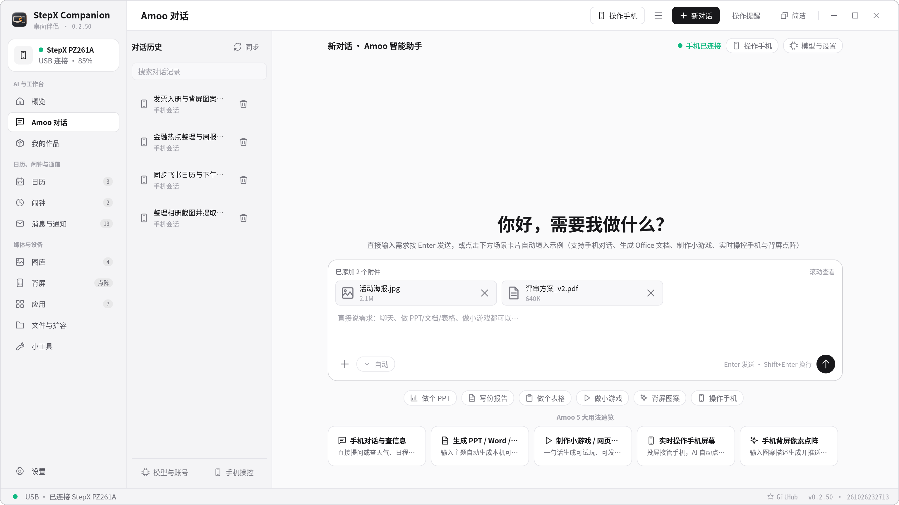
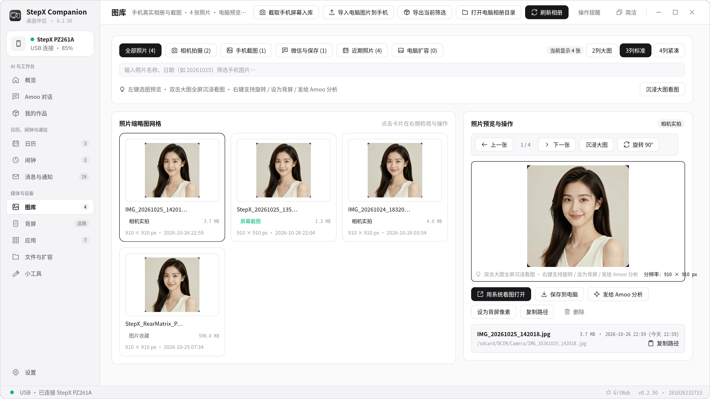
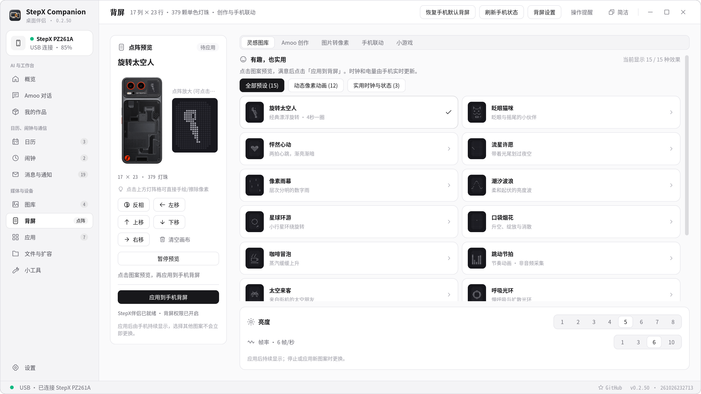
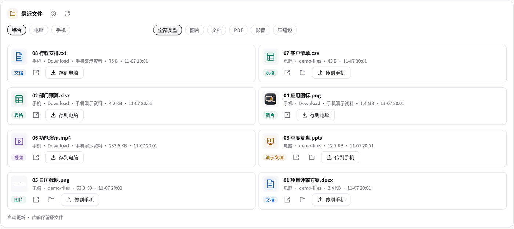

# 功能使用说明 · 0.2.177

[返回首页](../README.md) · [功能对应版本与日期](FEATURE_HISTORY.md)

以下说明当前能力；0.2.60 已有功能与后续新增、修正分别列在版本索引中。文内 Amoo、相册与背屏配图为 0.2.50 基线截图，用于解释原有功能；最新首页、提醒、搜索及最近文件见 [README](../README.md)。

### Amoo：聊完之后，还能接着做

- **继续手机上的对话**：沿用手机 Amoo 账号，收发文字、图片与文件；格式化显示回复，支持选中复制、右键操作和朗读。
- **处理工作资料**：生成可编辑的 Word、Excel 与 PPT，预览成果并继续修改；图片结果下载后缓存在电脑，减少短期链接失效影响。
- **制作手机小应用**：调用手机模型或自己配置的模型，生成应用、在电脑浏览器检查，再发送至伴侣离线作品库。Studio 官网草稿和编辑入口也在工作流中衔接。
- **普通聊天保持轻松**：可识别文件、图片或应用需求，也可改回普通对话；工具过程收起，成果单独成卡片。
- **能力和用量可见**：查看接口可获取的技能、记忆、模型、MCP、定时任务及 Token 信息；缺失数据不会冒充账单。
- **简洁模式**：小窗口里继续当前对话；输入、附件、发送合在一起，切换窗口保留草稿和附件。

**用上手机已有的百亿 Token 权益**：已开通相应购机权益的用户，手机模型任务沿用原账号的额度与计量规则。额度、有效期、模型以手机账号实际可用为准，客户端不额外赠送 Token。自有模型 API 与 GUI Agent 模型服务独立配置、独立计费。

### 手机空间，按需释放

| 功能 | 文件在哪里 | 使用方式 |
| --- | --- | --- |
| **空间压缩与清理** | 留在手机 | 对适合的文档压缩，核对收益后处理；集中查看重复文件和可清理项，支持还原压缩文件 |
| **存储扩容** | 电脑保存原件，手机保留入口 | 选择照片、视频、文档与保留时间，确认规则后自动迁移；保存并校验成功才清理手机原件，支持取回 |
| **相册联动** | 手机照片与扩容原件统一查看 | 按类型和来源筛选、预览、排序；隐藏内部缩略图及回收站残留，离线状态明确提示 |

### 背屏不只是装饰

- **图案与动画**：17 × 23 点阵、379 颗灯珠；太空人、像素动画、图片转点阵，调亮度、速度与时长，先预览再应用。
- **用背屏打游戏**：「重力对齐」三敲开局，左右倾斜控制长条，5 格到 1 格循环挑战，累计积分，翻到正面退出。
- **脱离电脑游玩**：安装并启用伴侣相应能力后，由手机运行；背屏输出仍受姿态保护和系统权限约束。

### Google Play 与小工具

在已适配固件上安装 Google Play 及必要组件，配套安装前检查、权限检查、回执和兼容性诊断。小工具还集中提供空间释放、手机 OTA 检测、投屏、APK 管理、输入法安装和伴侣安装维护。

**Google Play 安装、GMS 登录和设备认证是不同事项。** 本项目不能给未经认证的机型授予 Google 认证；X 原生 Google 登录的设备证明拒绝尚未解决。公开包不分发 Google APK，安装流程使用指定上游来源并核验完整性。

## 常用能力，一个客户端完成

| 能力 | 可以做什么 |
| --- | --- |
| **投屏与控制** | USB / 无线查看画面；鼠标键盘操作；跟随画面的侧栏提供主页、返回、多任务、音量、截图和结束投屏 |
| **局域网投屏** | 手机连接本电脑后，同网浏览器扫码观看；每次启动独立链接，远端控制默认关闭。DLNA / 旧版 AirPlay 为实验性适配 |
| **文件互传** | 目录导航、上传下载、双击打开、右键菜单、重命名与回收站；传输状态和校验结果可查 |
| **应用商店** | 分类搜索、详情与截图、来源选择、下载 APK、安装及更新检查；安装前核对包名与签名 |
| **应用管理** | 真实名称与图标，查看列表、安装 APK、导出及卸载；操作前显示范围和确认 |
| **短信、电话、通知** | 读取手机返回的数据，在支持授权下发短信、拨号、回复通知；失败原因明确显示 |
| **相册、日历、闹钟** | 在电脑整理手机照片，查看日程及闹钟，关联 Amoo 处理入口 |
| **设备状态** | 首页电池、温度、存储、可获取的 Token 用量；底部统一显示连接、版本、加载与更新状态 |
| **连接恢复** | USB 引导、扫码/数字配对、已信任设备发现；同局域网动态端口重连，适配固件可配置重启恢复 |

*以上为应用实际渲染的演示界面，使用虚构数据，不代表所有机型均已通过端到端测试。*

## StepX伴侣：手机端的协作入口

扫码连接、文件接收、离线作品库、背屏游戏和后台协作集中在同一个 App。权限按功能说明，安装器检查包名与签名，系统适配核对设备身份和固件；重启后首次密码解锁仍需本人完成。

实验性 GUI Agent 支持手机执行看屏、点击、滑动和输入，桌面提供控制入口。公开仓库包含适配层和构建脚本，**普通公开 APK 不包含许可尚未明确的 Neo 上游执行引擎**；完整组合构建见 [Neo 适配说明](../desktop/neo-agent-adapter/README.md)。完整引擎配置后，可在「小工具 → GUI Agent → 连接 Amoo」安装调用技能，再新建普通对话委派任务。已在 PZ261A / StepAOS 1.0.0.2（172 固件）验证“打开京东，我的订单”通过原生 MCP 在后台虚拟屏完成，手机前台仍可使用；其他应用兼容性需分别验证。手机需解锁，GUI Agent 的视觉模型独立配置。

Studio 首次网页登录需要本人完成；之后可以复用已授权会话。已验证的手机交付路径是伴侣离线作品库；官网云预览仍受平台状态限制。详见 [Studio 说明](STUDIO_INTEGRATION.md) 与 [验收记录](STUDIO_VERIFICATION.md)。

