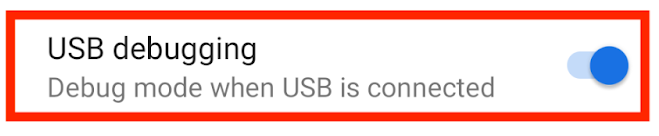
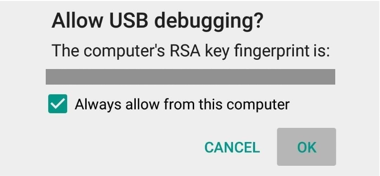

# 第一次连接

*Android 官方实机示例；电脑端的连接结果仍以实际检测为准。*

## 电脑端无需预装 ADB

0.2.1 及后续完整发布包自带 ADB、scrcpy 和安装运行时。Windows 请先完整解压 ZIP，再启动 EXE；macOS 请保留整个 StepX Companion.app，拖入 Applications 后启动。不要只复制 EXE，也不要从压缩包中直接运行。客户端优先使用包内工具，不依赖 Android Studio 或终端 PATH。

macOS 请根据芯片选择 Apple Silicon（arm64）或 Intel（x86_64）包。Google 安装下载与恢复记录保存在 `~/Library/Application Support/StepX Companion/google-play/`，无需写入应用包。发布包目前没有 Apple Developer 公证；首次打开可能需要在系统「隐私与安全性」中确认。

## 首次启动：开启 ADB

新用户首次启动会看到三步图文连接弹窗。每一步展示真实 Android 官方实机截图，保留原控件，并在图外用中文标出点击位置；不同机型的菜单名称可能略有不同。可点「稍后设置」关闭，之后从「连接设备 → 如何开启 ADB」重新打开；已连接过或已跳过的用户不会重复收到弹窗。

*Google / Android Developers，CC BY 4.0；官方实机示例，并非当前接入手机的截图。原图来源见 [素材清单](../desktop/assets/connection-guide/sources.json)。*

1. **开发者选项**：在手机「设置 → 关于手机 → 版本信息」中，连续点击「版本号」7 次，按手机提示完成本人验证。部分系统将它放在「软件信息」下。
2. **USB 调试**：回到设置搜索「开发者选项」，打开其中的「USB 调试」，确认系统提示。
3. **连接并授权**：用支持数据传输的 USB 线连接电脑，保持手机解锁，在「允许 USB 调试」弹窗中核对并允许这台电脑。只有自己的可信电脑才勾选「一律允许」。

点击「已允许，重新检测」后，弹窗根据真实连接状态显示结果。待授权时在手机确认；离线时解锁并重插数据线；未检测到时更换线材或 USB 接口。验证连接成功后，可进入桌面或继续安装 StepX伴侣。

参考 [Android 官方连接说明](https://developer.android.com/codelabs/basic-android-kotlin-compose-connect-device)。菜单名称可能因系统版本不同而变化。

## USB 驱动与诊断

Windows 若无法识别手机，请使用手机厂商提供的 USB 驱动。Linux 可能需要发行版的 Android udev 规则并重新连接设备。可运行 `stepx-companion --doctor` 检查 ADB；诊断输出含设备信息，分享前请脱敏。

## 安装 StepX伴侣

进入「小工具 → StepX伴侣/系统服务」或连接向导，选择安装。手机可能要求确认 USB 安装、通知、摄像头（扫码）与相关服务权限。按界面说明授予当前功能需要的权限。系统权限或 root 相关能力仅在已支持的设备环境可用；安装普通 APK 不会自动取得 root。

## 无线扫码与文件互传

先完成 USB 授权并安装／修复 StepX伴侣，手机与电脑连接同一可信 Wi-Fi。在电脑「连接设备」显示二维码，手机点「扫码连接」会直接打开相机，也可从相册选择二维码。识别后确认连接的电脑；若系统首次询问当前 Wi-Fi 的无线调试授权，按系统提示确认。不要公开二维码或配对码。

完成配对后，伴侣会开启「同一局域网自动连接」。以后电脑运行 StepX Companion、手机回到已授权网络时，客户端会按记住的设备身份重新连接，无需重复扫码；IP 和无线端口变化时优先通过局域网发现恢复。连接中断时保留当前会话、附件和草稿。手机「连接管理」可暂停自动连接，暂停选择会保留；要撤销电脑访问，请在系统无线调试中删除该电脑的配对授权。

连接选项提供系统六位配对码与修复说明。相机权限、扫码系统服务和后台任务权限分别显示，不会因为熄屏任务适配失败而隐藏扫码入口。公共网络隔离、防火墙、电脑未运行、手机关闭开发者选项或撤销授权仍会影响连接。系统重启后的权限保留尚需按固件验证；如果手机提示扫码服务或无线设置权限不可用，请用 USB 修复。已配对网络的日常重连与新网络首次授权是不同步骤。

## Amoo 与 Work

手机先登录 Amoo，再在桌面同步会话。账号与 token 用量可从「首页」右上角「账号与用量」查看。Work 可选择手机处理、桌面协作或图片创作。桌面协作应选择专用工作文件夹，添加资料后描述任务，在成果栏查看输出。若模型或权限不可用，按返回状态处理，不要反复提交相同任务。

## 附件与缓存

成功下载的附件可在本地缓存中再次预览。已经过期且从未缓存的链接无法凭空恢复；可在手机重新获取原文件后导入。图片分析依赖当前模型支持图片输入。

## 更新和清理

工具箱中的更新检查面向手机 OTA。清理、卸载及系统修改前核对对象和备份；不要将其他机型固件安装到当前设备。Google 兼容性工具不提供设备认证保证。

Google 应用无法登录时，可在「小工具 → Google Play」查看「基础服务与通用登录」分项结果，并使用「修复 Google 服务」。已适配的 172 固件支持重启及 Google 组件更新后自动恢复，保留账号与数据。首次重启仍需手动解锁；具体支持范围和实测结果见 [Google 服务验收](GOOGLE_SERVICES_VERIFICATION.md)。

## Studio 项目与草稿

1. 在小工具安装或更新 StepX伴侣，进入桌面 Studio。
2. 点击“连接 Studio 官网”，在手机出现的官方页面使用与 Amoo 相同的账号登录，点击“完成登录”。首次需自行完成验证码或密码验证。
3. 回到电脑，“官网项目”会自动显示应用、技能和智能体项目，包含草稿。选中项目可继续编辑；电脑在独立 Chrome / Edge 窗口复用伴侣的官网会话，无需再次登录。
4. 在官网生成测试包，连接 Amoo 手机账号后，在“手机可用”查看并打开测试版本，再验收实际交互。构建成功不等于运行成功；本次官网测试包仍遇到云预览未就绪，详见 [验证记录](STUDIO_VERIFICATION.md)。技能与智能体请在 Amoo 确认安装。
5. 选择“分享作品”保存到收藏，再生成二维码或复制分享文案。草稿编辑入口不作为公共体验链接分享。

以后进入 Studio 自动同步，离开此模块停止轮询。需要换账号时，在“设置”断开官网，再重新登录；断开不会删除官网项目或本机收藏。详见 [Studio 集成说明](STUDIO_INTEGRATION.md)。

## Studio 本地工作台

1. 在 Studio → 设置中填写自己的 API 地址、协议与模型，输入 API Key 并保存，然后点击“测试连接”。密钥框留空可保留同服务的已有密钥；更换服务地址需重新填写。
2. 进入“工作台”，描述需要的离线小应用，例如“一个支持中文待办、完成状态和本地保存的手机工具”。开始后可查看生成、验证与修复进度，也可停止。
3. 验收通过后，先预览或查看检查报告，再选择“发送到手机”。手机伴侣的作品库会保留此作品，断开电脑也可运行。
4. 若要继续在官网编辑，连接官网账号，读取官网模型目录并选择模型，再点击“同步到 Studio”。此操作创建新草稿，不覆盖已有作品。

本机需要 Chrome 或 Edge 执行浏览器检查；手机离线作品禁止外部联网和系统接口。模型目录能列出不代表当前套餐必然有调用权限，应以真实连接测试结果为准。详见 [Studio 集成说明](STUDIO_INTEGRATION.md)。

## 内置 GUI Agent

完整适配模式只安装一个 StepX伴侣 App，Neo 执行器与模型设置位于同一个 APK。当前需按 [构建说明](../desktop/neo-agent-adapter/README.md) 在本机生成带 `--embedded` 的完整包，再从小工具安装检查；普通公开 APK 不包含上游执行引擎。

在手机伴侣的 GUI Agent 设置中配置自己的视觉模型 API、协议、密钥和允许操作的应用，按提示启用无障碍服务。规划与执行循环由手机完成，手机直接请求模型服务；模型推理仍需要网络和该服务的账号额度，不默认使用 Amoo Token。电脑断开后不需要 desktop 代跑任务。首次先验收一个只读任务，再使用多步骤操作；任务受系统锁屏、应用范围与人工接管控制。

## 设置

左侧底部进入 **设置**。选择仅修改草稿；底部点击 **确认保存**，核对变更后点击 **保存并应用** 才会生效。取消保留选择，离开有未保存提醒：

- **通用**：外观、减少动态效果、系统托盘、点关闭后是否留在后台。关闭托盘时，会一并关闭后台隐藏。完整与简洁窗口的尺寸分别自动记忆。
- **文件与存储**：下载和接收文件的默认文件夹；手机存储扩容的保存位置与迁移规则从这里进入管理。更换下载位置不会搬动已有文件。
- **Amoo Work**：项目文件夹，以及是否自动把桌面协作的交付成果发送到手机。自动发送默认关闭，只传输 `Amoo Work Outputs` 内本次生成的成果，原件仍在电脑；手机伴侣“文件 → 收到的文件”查看。未送达的成果在重连后重试，单个文件最大 256 MB。项目源码、依赖和临时文件不自动同步。
- **通知**：提醒范围、弹窗方式、正文隐私及验证码复制。
- **关于**：版本、更新日志、项目说明与联系方式。

Android 伴侣“设置 → 显示”同样提供“减少动态效果”，也尊重 Android 系统的动画设置。

## 图文与操作短视频

「设置 → 关于 → 图文更新说明」可回看公开版 0.2.60 之后的累计变化。作者完整求职介绍、联系方式和双码保留在顶部；分类目录可以直接查看弹窗、胶囊、首页、最近文件、搜索、AI 与性能等内容。真实操作视频在同一窗口内播放、暂停和快跳，不打开浏览器。阅读与播放不操作手机、不发消息、不拨号。首次连接教程仍从「连接设备 → 如何开启 ADB」单独打开。
