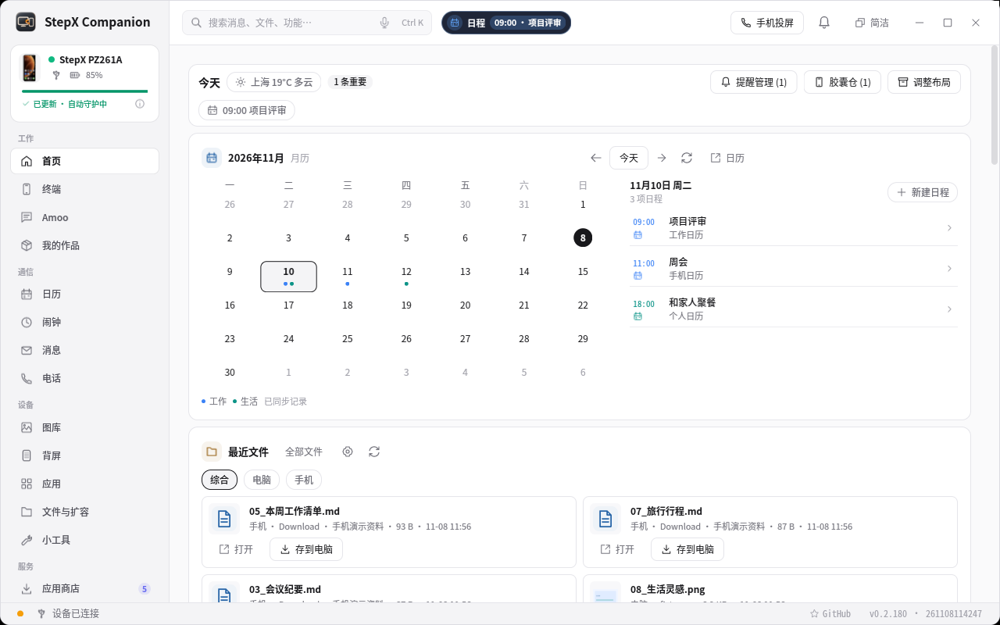

# StepX Companion 0.2.180

**累计更新：公开版 0.2.60（2026-10-28） → 0.2.180（2026-11-08）**

**以人为中心，让 AI 贯通终端与服务。**

连接手机与电脑上的消息、文件、安排、工具与 AI 成果，让提醒及时到达，让工作与生活跨端继续。

## 先看每天用得到的四块

### 首页：把今天要做的事放在手边

完整月历优先，工作 / 生活用双色点区分；最近文件、待处理、工作安排、继续工作与生活工具按使用场景排序。保留全部 16 个模块，支持移动、缩放、显隐、撤销、取消与保存。

0.2.178–0.2.180 继续优化：首页采用月历、列表、摘要、数据、操作五类卡片，同排底边对齐；结构根据真实宽高变化，宽卡展示更多信息，窄卡突出重点，独占一行时利用可用空间。调整尺寸可直接选择或拖动，移动、隐藏等动作有文字与 SVG 提示；快速发起会保留输入并明确显示当前选择。

### 桌面弹窗：及时提醒，也给操作留空间

最新消息和验证码优先；同会话集中提醒，红包使用独立暖红色样式。正在输入、中文组词或操作菜单时保留当前卡片，不抢焦点。按应用暂停提醒，或「清理本次弹窗」只收起当前及排队的一批，保留历史、未读和未来新提醒。已展示事件持久记录，减少重启、重连后的旧提醒重放。

### 实况胶囊：关心还没办完的事

日程、取件、配送、电话等状态集中展示。物流区分寄件、收件与未知，完成后收起；规则先判断，开启 Agent 后仅对有歧义的状态复核，避免把发给别人的快递误当成自己待收。

### 最近文件：拿到资料，马上接着做

首页与「文件与扩容」都有最近文件，合并手机与电脑来源，可打开、传手机或存电脑。不限定内容来自哪款 AI 工具或办公软件。0.2.178 起，顶部搜索打开后直接显示最近文件，展示类型、时间、手机 / 电脑来源，点击即可打开；不再先展示功能快捷菜单。

## 其他完整使用场景

| 想做的事 | 当前能力 |
| --- | --- |
| 找一条消息、一个文件或一段讨论 | 全局搜索消息、Amoo、文件、作品、日历、闹钟、联系人、电话、背屏、应用与功能；默认综合，可切换手机 / 电脑。 |
| 手机放下，电脑继续处理 | 授权后的熄屏后台同步；来电弹窗显示号码与联系人，支持接听、挂断和回拨。电脑双向通话音频目前以 Linux + 支持固件的实测为准。 |
| 让讨论变成能继续用的成果 | 使用所选 AI 来源，结合已同步上下文整理方案、待办及日周月回顾，保留依据；文件可以回到手机。 |
| 管理一天的安排 | 日历与重复日程、闹钟、专注与提醒集中使用，日期定位和工作 / 生活标识一致。 |
| 使用手机特有能力 | 背屏创作与控制、投屏、相册、文件扩容、应用与商店、设备工具继续保留；适用功能优先使用手机原生能力。 |

Amoo、背屏、投屏、扩容等在 0.2.60 基线前已具备，本轮是在原能力上改进；最近文件、全局搜索等为本轮新增。具体新增、改版与修复日期见 [功能版本索引](https://github.com/xydzf520/stepx/blob/main/docs/FEATURE_HISTORY.md)。

## 响应性、稳定性与数据保护

- **同步与生成分开。** 消息后台读取独立于页面和 AI 生成任务。连接恢复核对真实读取回执，失败保留缓存并显示状态，避免旧数据冒充新同步。
- **只处理需要变化的部分。** 事务、增量写入、索引、分页与缓存减少重复处理；首页按模块实际尺寸构建核心内容，最近文件按可见数量读取，拖动过程合并指针刷新。
- **数字说明范围。** 0.2.154 同机合成数据测试中，2 万条记录修改 1,000 条，热快照写入中位数从 44.054 ms 降至 8.545 ms；完整快照仍慢于同轮 JSON。首页构建耗时也不等于 GPU 帧率、启动速度或手机网络延迟。[测量方法与结果](https://github.com/xydzf520/stepx/blob/main/docs/PERFORMANCE.md)。
- **减少不必要的手机轮询。** 电池广播缓存随已有快照更新，配合有节制的校验与退避，显示充电、充满、接电未充电以及电量变化。
- **跨平台修复。** macOS 文件选择 / 保存改为隔离进程与异步续办，修复原生界面与 Retina 参数、网络非阻塞读取；Windows 修复数据库路径迁移和文件占用处理，并随包校验必需运行库。
- **避免重复提交与丢数据。** Amoo 已收到部分响应后中断时不自动重放请求；迁移原子提交，失败不先删原数据，备份与运行目录有明确边界。
- **发布只包含审核资源。** 公开源码与安装包使用明确清单，排除开发机设备记录、运行数据库、日志、诊断截图、备份和凭据。

## 视频

[完整产品介绍](https://github.com/xydzf520/stepx/releases/download/v0.2.180/StepX-product-0.2.180.mp4) · [0.2.60 → 0.2.180 更新介绍](https://github.com/xydzf520/stepx/releases/download/v0.2.180/StepX-0.2.60-to-0.2.180.mp4) · [逐版记录](https://github.com/xydzf520/stepx/blob/main/CHANGELOG.md)

视频使用真实客户端与隔离演示数据，从完整界面点击进入模块；演示画面不代替真机验收。

消息仅覆盖已同步来源，通知不等于微信完整历史。手机文件主要按名称检索，电脑文本检索限指定目录。后台回复、AI 生成依赖实际接口与账号权限。原厂通用离线 ASR / TTS 未开放验证，不以云端结果代替。电脑通话音频、macOS 全功能仍需按具体平台与设备核验；macOS 包未 Apple 公证。
