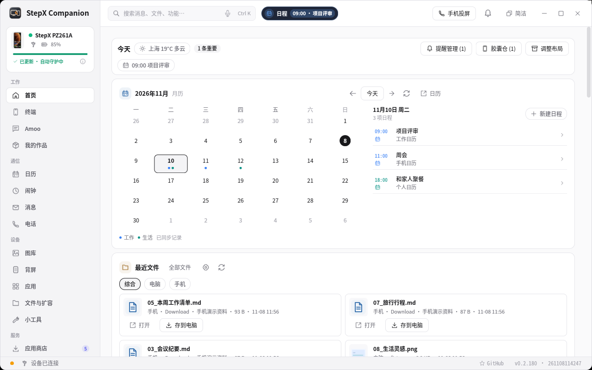

# StepX Companion 0.2.181

**本次维护更新：0.2.180 → 0.2.181（2026-11-08）。累计功能回顾：0.2.60 → 0.2.181。**

这版重点解决初次安装、先安装伴侣再安装 Google，以及组件更新后“旧记录显示成功，实际仍不能用”的问题。感谢 [issue #4](https://github.com/xydzf520/stepx/issues/4) 和 [issue #5](https://github.com/xydzf520/stepx/issues/5) 提供可复查的现场信息。

## 已有权限不必撤销，继续完成伴侣安装

旧版授权记录与新的开机适配取证格式不一致时，先读取当前权限，保存新的取证并归档旧记录，再继续安装。不再要求按特定顺序反复撤销、授权。身份不符、记录被修改或读取失败仍会停止，并保留恢复资料。

手机伴侣更新为 **0.1.46（47）**。配对检查通过签名伴侣读取实时 Binder 状态，区分系统服务与 Shell 服务；系统服务已就绪时不重复启动另一套服务。旧伴侣尚未支持实时检查时显示未知，不将缓存的 `pairing.json` 当成当前成功。停止 Shell 服务不会停止 `system_server`。

## Google 安装受阻时，处理原因而不是反复重试

- **逐包安装限制：** 总开关未开启时提示用户到手机开启；仅为本次安装临时允许目标包，完成或失败后恢复原设置，不自动打开全局开关。
- **真实固件记录：** 保存手机当前受支持固件指纹，避免 `/12` 手机与配置示例中的 `/172` 不一致。
- **备份访问限制：** 无法读取的辅助元数据单独记录；原启动文件备份和校验仍是硬性条件，不关闭 SELinux，也不把缺失资料称为完整备份。
- **已有启动备份：** 原厂字节一致的已知备份可以核对后复用，保留原件；不会为继续安装而盲目删除备份。
- **较大安装载荷：** 先分片暂存，再校验并执行同一份内容，避免超过 RootBridge 的 IPC 请求限制。

## 商店更新后，告诉你什么时候需要修复

状态检查重新核对组件版本及当前权限，识别组件自更新、新增权限和过期成功回执，提示使用「修复 Google 服务」。修复保留已有账号和数据。

**权限恢复不等于 Google 认证通过。** Play Integrity、Firebase App Check、厂商认证和具体应用的服务资格仍有独立条件；不能用安装成功推断所有应用可用。

## 原有功能与演示继续保留

首页、最近文件、桌面提醒、胶囊、搜索、电话、AI 成果和设备工具不变更入口。完整场景可查看 [0.2.60 → 0.2.180 图文介绍](https://github.com/xydzf520/stepx/blob/main/docs/RELEASE_0_2_180.md)、[功能与版本索引](https://github.com/xydzf520/stepx/blob/main/docs/FEATURE_HISTORY.md)。

[完整产品视频（0.2.180）](https://github.com/xydzf520/stepx/releases/download/v0.2.180/StepX-product-0.2.180.mp4) · [累计更新视频（0.2.60 → 0.2.180）](https://github.com/xydzf520/stepx/releases/download/v0.2.180/StepX-0.2.60-to-0.2.180.mp4)

本次没有新录制的视频；图像与视频仍准确标注为 0.2.180 的隔离演示，不作为本次手机端修复的真机验收证据。各平台安装包以发布页实际可下载内容为准。
