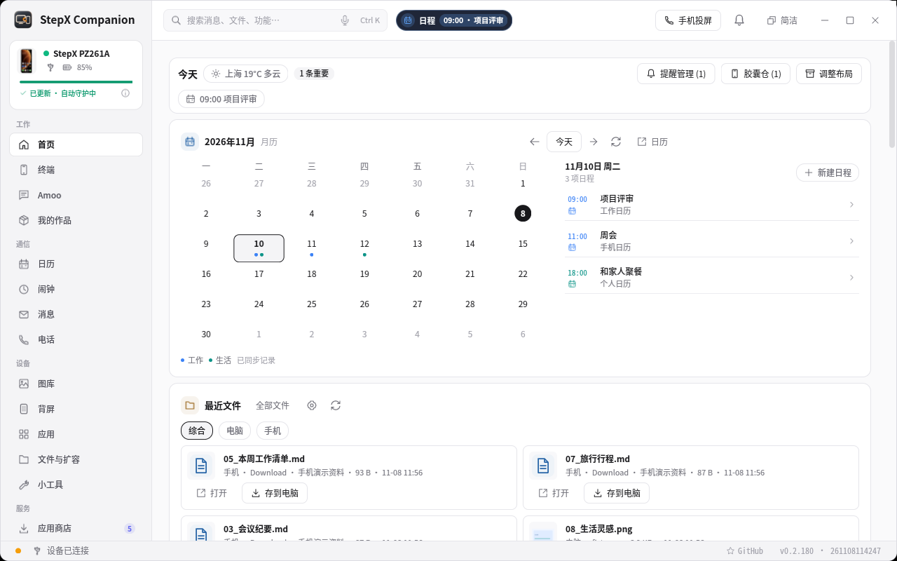
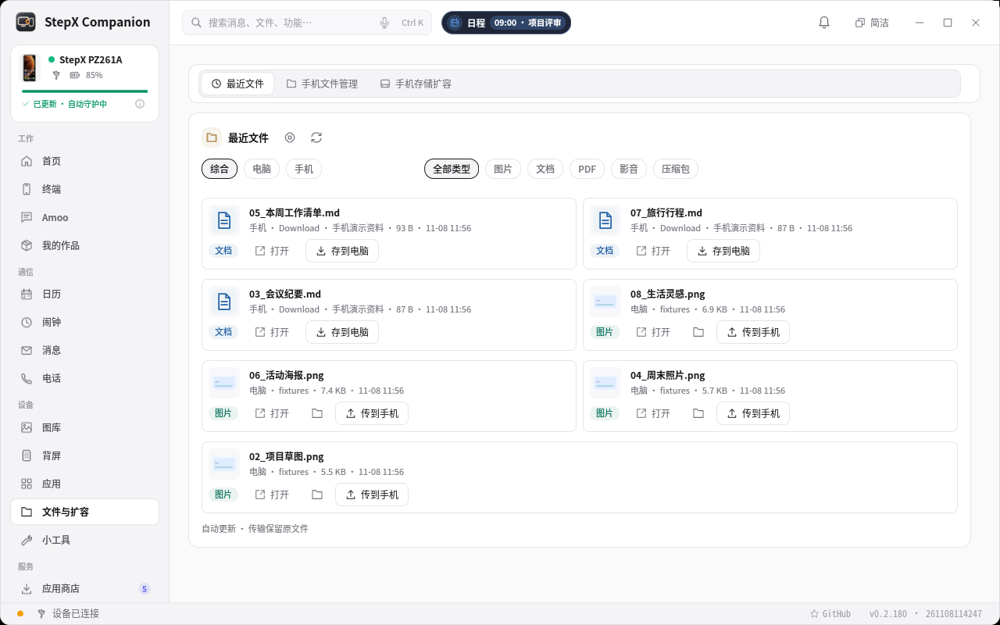

# StepX Companion 0.2.183 · 0.2.60 起的更新合集

**2026-10-28 → 2026-11-09 · 以下为升级到 0.2.183 后的功能体验**

**本次维护更新：0.2.182 → 0.2.183。** Google Play 的部分安装、安装中断和原电脑记录缺失，现在可先验证再补齐；保留账号与已装新版，并修正失败提示和安装状态误报。

同时修复数据库连接已关闭后，备份恢复仍可能误报“客户端正在运行”的问题；其他仍在使用数据库的连接继续受到保护。

本版验证：177 项 Google Python 测试、35 项 Rust Google 测试通过；在受支持 `/12` 固件的真机上走完整已有安装流程，Google 版本及账号数量前后相同，153/153 权限检查通过。缺包与中断场景使用隔离模拟；未在已登录手机上制造故障，未重新验收 Play 下载或跨重启恢复。[查看验证范围](https://github.com/xydzf520/stepx/blob/v0.2.183/docs/google-install-recovery-0.2.183.md)。

**以人为中心，让 AI 贯通终端与服务。**

手机上的重要消息、刚收到的文件、今天的安排，都能在电脑上接着处理。这次更新重点完善了首页、提醒、跨端资料和无线协作，也改善了数据增多后的响应与稳定性。

## 1. 首页成为工作与生活的日常入口

- **先看整个月，再处理今天的事。** 完整月历优先展示，工作、生活用两种颜色标记，日程、待处理事项和最近文件集中在手边。
- **按自己的习惯摆放。** 16 个模块可移动、缩放、隐藏；调整后可保存，也能撤销或取消。
- **大小窗口都能抓住重点。** 卡片随宽高调整内容，同排对齐；窄卡保留核心信息，宽卡展示更多内容。平时右键即可使用模块快捷操作。

## 2. 重要消息及时到，正在做的事不被打断

- **新消息与验证码优先显示，红包更醒目。** 同一会话合并提醒，重启或重连后减少旧消息重复弹出。
- **回复时保持稳定。** 弹窗固定尺寸，输入和中文组词期间保持当前消息，避免跳动、切卡和抢焦点。
- **提醒太多，一键收起。** 顶部直接提供「清空、菜单、关闭」；清空当前及排队的普通弹窗，消息历史、未读状态和之后的新提醒仍保留。也可按应用暂停提醒。

## 3. 实况胶囊，跟进真正还没办完的事

日程、取件、配送和未接来电集中展示，减少反复打开手机查看状态。

物流会区分**寄给别人、自己收件和信息不明**，按订单合并状态；已完成的事项及时收起，避免旧取件码再次提醒。规则先判断，开启 Agent 后再复核有歧义的信息；未接来电可直接进入回拨操作。

## 4. 最近文件与全局搜索，让资料跨端接着用

- **刚下载、生成或收到的文件，首页就能找到。** 手机和电脑的图片、文档、PDF 等合并显示，不限定来自哪款 AI 或办公软件。
- **找到后直接操作。** 打开文件、传到手机或存到电脑；「文件与扩容」默认进入最近文件。
- **少找一层入口。** 点开顶部搜索即可看到最近文件；输入关键词后，统一查找已同步消息、文件、Amoo 讨论、日程和联系人等内容，并可筛选手机或电脑来源。

## 5. 手机熄屏，消息和来电仍能在电脑处理

- **纯无线后台同步更可靠。** 改善“显示在线但读取停滞”的恢复；消息读取与 AI 长任务分开，生成过程中也能继续同步。
- **来电有独立弹窗。** 显示号码与已识别联系人，提供手机接听、电脑接听、挂断和回拨入口，并显示实际使用的音频端。

已在支持固件的手机与 Linux 电脑组合上，完成纯无线、熄屏来电及双向音频验证。电脑通话音频的可用范围仍以具体设备和平台适配为准。

## 6. AI 从聊天延伸到整理资料与继续工作

结合已同步的讨论和资料，整理方案、待办及日／周／月回顾，保留原文依据和人工编辑，生成的成果可继续修改并传回手机。

Agent 有独立设置，覆盖找资料、拟回复、整理待办和日程草稿等常用场景；规则优先，必要时调用所选 AI 来源。失败时保留草稿与附件，部分响应后断线不自动重复提交，减少重复任务和成果丢失。

## 7. 数据多了，减少重复读取与等待

- **增量保存、索引与缓存配合。** 更新时尽量只处理变化的记录，长列表分批显示，首页最近文件按可见数量读取。
- **拖动和缩放更连贯。** 减少宽窗口重复布局计算，合并拖动刷新，让模块调整更稳定。
- **恢复与迁移更稳妥。** 改善 Windows 数据路径迁移、macOS 文件选择和保存窗口等问题；操作失败可查看原因，并对支持的操作重试。

同机合成数据测试中，2 万条记录修改 1,000 条，热快照写入中位数由 **44.054 ms 降至 8.545 ms**。这是该增量场景的测量结果，完整快照仍有成本；[查看性能测量范围](https://github.com/xydzf520/stepx/blob/v0.2.183/docs/PERFORMANCE.md)。

## 8. Google 安装与更新后，减少反复排障

- **之前只装了一部分，也能继续。** 安装前验证所有已有组件的签名，只补齐缺项；换电脑或没有原安装记录时，建立独立的恢复记录，保留已有新版、账号和应用数据。
- **断线、下载损坏后不必从头重来。** 缓存校验失败可重新获取，进度在每步完成后保存；从同一入口重试，先重新核对手机状态，不盲目重复安装。
- **失败原因与下一步更清楚。** 显示已安装数量、缺失项和具体原因；权限、商店或账号尚未查清时不显示成功。未适配固件不会被误报成网络问题反复重试。
- **更新后仍可自动维护。** 手机在组件更新后核验已支持的权限缺口，电脑空闲时补检；可立即检查或暂停。通话和前台任务优先，保留原有账号和应用数据。

网络、账号与 Google 设备认证有独立条件，权限恢复不能保证解决。未经验证的固件（包括此前反馈的 `/6`）不会套用 `/12` 的系统适配；旧监控首次升级可能短暂重建网关。

---

**原有能力继续保留：** 背屏创作与控制、投屏、相册、文件扩容、应用与商店。本轮同时改善了原生接口调用和操作后的状态核验。

**看实际操作：** [完整产品介绍](https://github.com/xydzf520/stepx/releases/download/v0.2.180/StepX-product-0.2.180.mp4) · [累计更新演示](https://github.com/xydzf520/stepx/releases/download/v0.2.180/StepX-0.2.60-to-0.2.180.mp4)

图片与视频来自 0.2.180 的真实客户端和隔离演示数据；本页文字已合并至 0.2.183。

适用范围与详细更新记录

- 消息与搜索以已同步内容为准，通知不等于完整聊天历史；手机文件主要按名称检索，电脑可检索指定目录内支持的文本。
- AI 与后台操作依赖所选来源、账号权限和手机实际开放能力；原厂通用离线语音转写与合成尚未验证可用。
- 熄屏后台读取需要已有有效授权；重启后的首次解锁和系统安全确认仍需在手机完成。macOS 安装包尚未 Apple 公证。
- [功能、版本与日期索引](https://github.com/xydzf520/stepx/blob/v0.2.183/docs/FEATURE_HISTORY.md) · [完整逐版更新记录](https://github.com/xydzf520/stepx/blob/v0.2.183/CHANGELOG.md) · [0.2.183 修复验证详情](https://github.com/xydzf520/stepx/blob/v0.2.183/docs/google-install-recovery-0.2.183.md)

